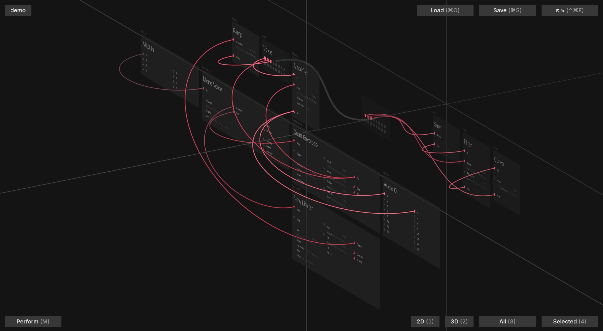

# Work In Progress 1

#wip #media

So, where am I actually at? Well, I'm not going to spend a lot of time on videos yet,
but the occasional screenshot, not a problem. So, here's a very simple multi-layer
patch, and using one of the false-colour lenses that can be applied to connections
and/or modules to add semantic meaning - in this case it's a simple hop count
metric.

It's coming along! This does actually make noise - it's a playable acid-style synth
voice, even if the modules themselves aren't final in some respects (more on that
when it makes sense later).