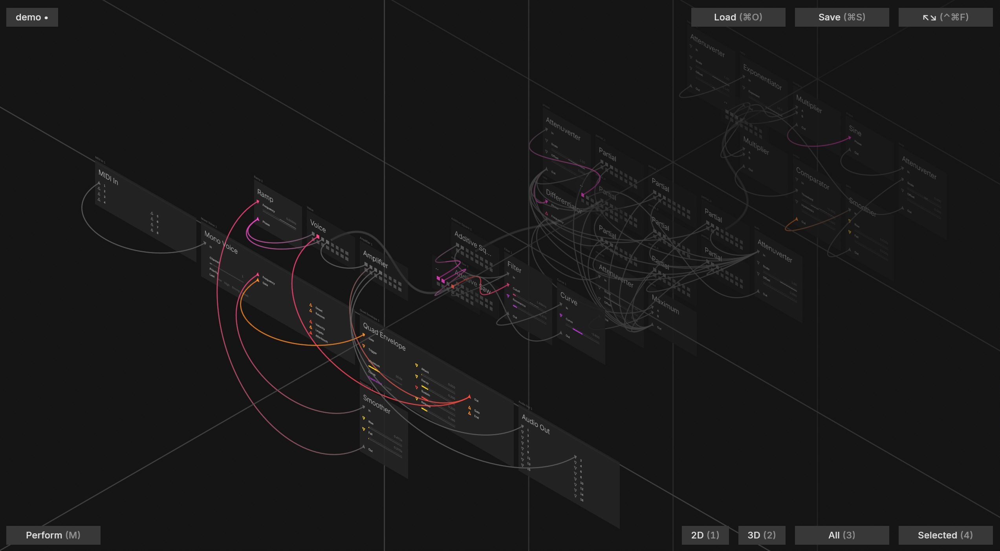

# Work In Progress 2

#wip #media

Yes, I'm not showing anything too different yet, but here's a little bit more to
go on with. This is showing an additive synth, with the first layer being i/o and
control, the second being the basic voice, the third being a composition of additive
partials (with adaptive anti-aliasing to scale partials based on Nyquist) and the
fourth being one of the partials.

It's a good example of the compositional nature of the instrument, building up
composable pieces and being able to combine them in interchangeable ways. Collapse
the layers down, and it's just a simple synth; expand and tweak, and you have all
of the potential of an infinite modular.